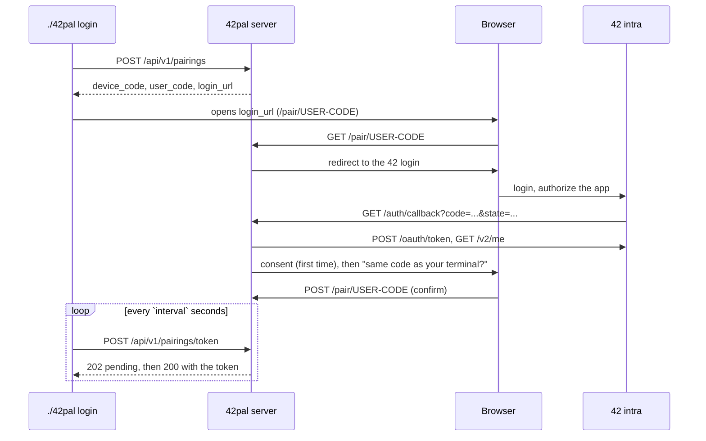

# Protocol of 42pal online

How the 42pal client talks to the 42pal server. The client is this repository; the server is private. This page covers the rules of every request and the login of a terminal; the ranked exam and the snapshots come with phases 3 and 4 of the plan (`docs/plans/42pal-online.md`).

## Every request

- **Server**: `https://<server>`, the address in `PAL42_SERVER` (`http://127.0.0.1:8000` until the domain is chosen). The API is under `/api/v1/`.
- **Body**: JSON in UTF-8, in both directions (`Content-Type: application/json`).
- **Version**: the client sends `X-42pal-Version: <its version>` (the one `./42pal --version` prints) with every API request. The server grades with the core of one version only: for any other version it answers `426` with the error `version`, and the client tells the student to update.
- **Errors**: any answer that is not `2xx` has the body `{"error": "<code>", "message": "<sentence>"}`. The code is for the program; the message, in English, is shown to the student as it is.
- **Login**: once a terminal is logged in, the client sends `Authorization: Bearer <token>`. A missing, unknown or revoked token gives `401` with the error `token`: the client says to log in again.

| Status | Error | When |
|---|---|---|
| 400 | `request` | the body is not the JSON expected |
| 401 | `token` | no token, or a token unknown or revoked |
| 403 | `refused` | the student refused the login, or the 42 account may not play ranked |
| 410 | `expired` | the pairing is too old, already used, or unknown |
| 426 | `version` | the client is not the version of the server |
| 429 | `busy` | too many requests; the message says when to try again |

## Logging in a terminal

`./42pal login` pairs the terminal with the student's 42 account. The secret of the 42 app never leaves the server: the browser does the 42 login with the server, and the terminal only waits for the result.



### `POST /api/v1/pairings`

Starts a pairing. Body: `{}`.

`201`:

```json
{
  "device_code": "a long random secret, known only by this terminal",
  "user_code": "BCDF-GHJK",
  "login_url": "https://<server>/pair/BCDF-GHJK",
  "interval": 2,
  "expires_in": 600
}
```

The client opens `login_url` in the browser and prints it with `user_code`: the page asks the student to check that the terminal shows the same code, so that a link sent by someone else cannot log in their terminal.

### `POST /api/v1/pairings/token`

Asks whether the student confirmed. Body: `{"device_code": "..."}`. The client asks every `interval` seconds, at most `expires_in` seconds.

- `202` `{"status": "pending"}`: not yet, ask again later.
- `200` `{"token": "...", "login": "jdoe", "campus": "Mulhouse"}`: logged in. The token is given once: the pairing is then used up.
- `403` `refused`: the student cancelled, or the account may not play ranked (the message says why).
- `410` `expired`: too late, or already used; run `./42pal login` again.

The client keeps the server, the token and the login in `~/.42pal/online.json`, readable by its owner only (mode 600). The server keeps only a hash of the token.

### `GET /api/v1/me`

Who the token belongs to. `200` `{"login": "jdoe", "campus": "Mulhouse", "kind": "student"}`; `kind` is `student` or `alumni`.

### `POST /api/v1/logout`

Revokes the token of the request. `204`, no body. `./42pal logout` then deletes `~/.42pal/online.json`; if the server cannot be reached, the file is deleted anyway and the client says the token is still valid on the server until the student deletes their account or logs out again.

## Who may play ranked

The server reads `/v2/me` on the intra and lets in active students of the 42 cursus and alumni. Pool candidates may not use the 42 API (its terms, article 1), so they get `refused`; the offline modes stay open to everyone. The server keeps the 42 id, the login, the primary campus and the kind of account: nothing else from the intra (no email, no name, no picture).
